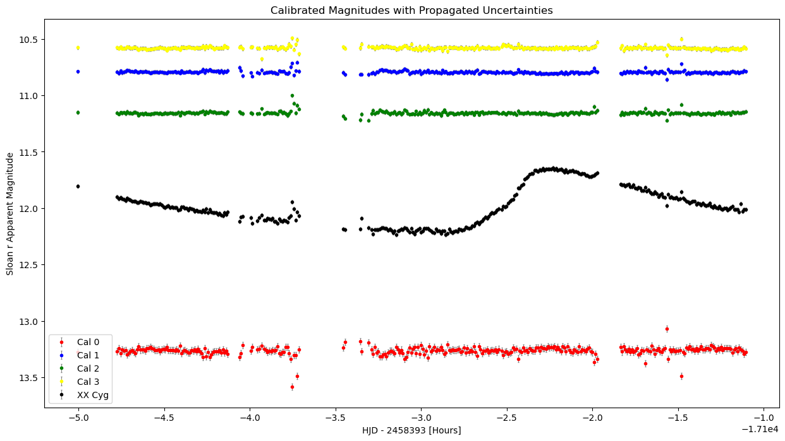
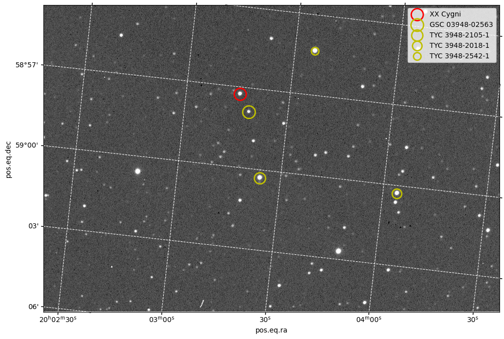
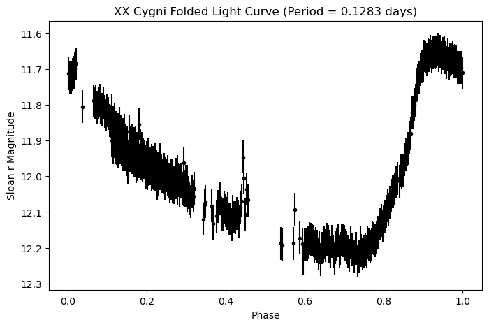

# Distance to XX Cygni from Time-Series Photometry

Measuring the distance to the pulsating star **XX Cygni** from a night of CCD images, using its pulsation period and the δ Scuti period–luminosity relation, then checking the result against the Gaia DR3 parallax distance.

## Result

| Quantity | Value |
|---|---|
| Pulsation period | 0.128 ± 0.048 days (3.08 hours) |
| Mean apparent magnitude ⟨r⟩ | 12.04 ± 0.05 |
| Absolute magnitude Mr | +1.26 |
| **Photometric distance** | **1.30 ± 0.39 kpc** |
| Gaia DR3 parallax distance | 1.16 ± 0.02 kpc |

The photometric distance agrees with Gaia within its uncertainty. The largest uncertainties come from the intrinsic scatter of the period–luminosity relation, the assumed extinction, and the period itself. The period is only loosely constrained because the data cover a single night.

## Method

All analysis is in [`XX_Cygni_distance.ipynb`](XX_Cygni_distance.ipynb):

1. **Data reduction:** ~300 Sloan-r CCD frames from a Celestron EdgeHD 14″ telescope. I inspected every frame and rejected 18 (cloud, a satellite streak), built a median-combined master flat, and flat-fielded the science images.
2. **Aperture photometry:** used WCS sky coordinates to place apertures on XX Cyg and four comparison stars, subtracted the sky background, and converted counts to instrumental magnitudes.
3. **Calibration:** set the magnitude zero-point of each frame from the comparison stars' catalogue (APASS) magnitudes, giving a calibration uncertainty of ±0.046 mag.
4. **Period:** a Lomb–Scargle periodogram of the unevenly sampled light curve, with the period uncertainty taken from the width of the peak.
5. **Uncertainties:** a CCD noise model (shot noise, sky, dark current, read noise) gives the per-frame errors, which are propagated through the calibration.
6. **Distance:** the δ Scuti period–luminosity relation gives the absolute magnitude, and the distance modulus (with extinction correction) gives the distance, with full error propagation.

| Field with comparison stars | Folded light curve |
|---|---|
|  |  |

## Notes

- Completed as part of the second-year astrophysics laboratory at the University of Exeter.
- The raw telescope images are **not included**, so the notebook is shown with its saved outputs. To re-run it, put the images in a `data/` folder as described in the first code cell.
- Requirements: `numpy`, `matplotlib`, `astropy`, `photutils` (see `requirements.txt`).

## References

- McNamara, D. H. (2011). The Period–Luminosity Relation of High-Amplitude δ Scuti and SX Phe Stars. *AJ*, 142, 110.
- Gaia Collaboration et al. (2023). Gaia Data Release 3. *A&A*, 674, A1.
- Lomb (1976); Scargle (1982), Lomb–Scargle periodogram.
